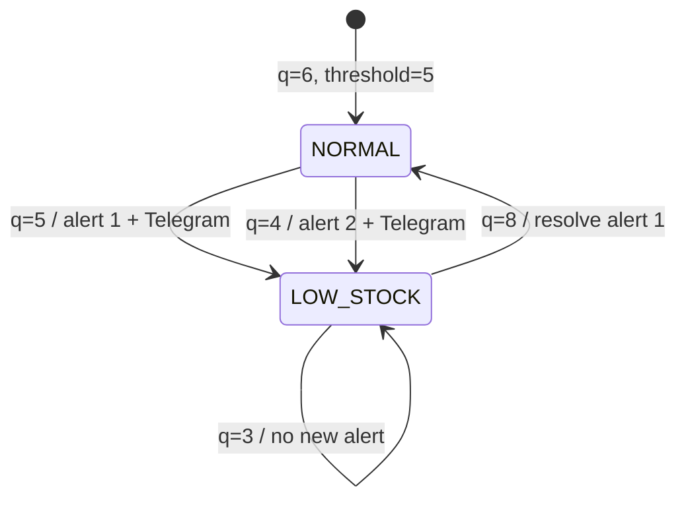

# StockNotifier — MVP Acceptance Criteria

**Gate M1 — Multi-location Database Foundation:** migration additive thực thi trên schema PostgreSQL cách ly; backfill shop có/không có location và baseline đúng; hoạt động location chưa xác minh là null; nhiều locations/shop, trùng GID khác shop hợp lệ, trùng composite key/foreign shop bị chặn. Session/settings/inventory/alerts/events/delivery metadata và indexes cũ giữ nguyên; Settings/Sync/alert/worker regression tests pass. M1 không bật discovery/multi-location runtime; các AC một location bên dưới vẫn áp dụng đến M2.

**Gate M2:** discovery đầy đủ active locations, chống partial/duplicate/tenant leak; sync tuần tự, transaction và baseline/version riêng, A thành công/B lỗi độc lập; race A/B/cùng A/threshold/webhook/inactive và rollback được kiểm thử PostgreSQL. Baseline/catch-up tạo ACTIVE origin BASELINE idempotent; threshold mới low tạo THRESHOLD_CHANGE ở tất cả monitored active locations; hai origin không được Telegram worker claim hoặc giả SENT/FAILED. Transition jobs cũ và retry/lease giữ nguyên. Đổi preference legacy sau discovery không resolve/invalidate/reset monitored data. Migration được test cách ly trước khi apply local, kiểm tra legacy data bảo toàn. Worker restart tiếp tục từ persisted lastSyncedAt/catch-up markers. Không tuyên bố realtime toàn bộ locations hoặc digest PASS trước M3/M4.

Các AC mô tả selected location/baseline không alert ở checklist Bước 1–8 dưới đây là hành vi legacy trước discovery; gate M2 và policy M2 trong PRD thay thế chúng sau cutover.

Đây là checklist **để test thật**, không phải tuyên bố các chức năng đã hoàn thành. `P0` bắt buộc cho bản local sau 3 ngày; `P1` làm nếu còn thời gian. Tham chiếu business rules tại [PRD.md](PRD.md).

## 1. Acceptance checklist

| ID | Priority | Tiêu chí nghiệm thu | Cách kiểm chứng |
| --- | --- | --- | --- |
| AC01 | P0 | Cài app vào Development Store, mở trong Shopify Admin, session tồn tại trong PostgreSQL | Install + reload + kiểm tra DB |
| AC02 | P0 | Không thể đọc/sửa dữ liệu của shop khác, các routes UI yêu cầu Shopify auth | Auth/tenant isolation tests |
| AC03 | P0 | Lấy locations thật, chọn và lưu một location, không sync trước khi chọn | GraphQL + UI reload |
| AC04 | P0 | Sync đủ tracked Inventory Items của location và toàn bộ variants qua pagination; một snapshot/item, metadata variants trong JSON, SKU/available đúng | Fixture một item có nhiều variants + đối chiếu Shopify Admin/DB |
| AC05 | P0 | Sync lặp không tạo duplicate; item thiếu available không được coi là `0`; scan thành công mới atomically cập nhật snapshots/`isCurrent`/`lastSyncedAt`, giữ lịch sử | Sync 2 lần; scan lỗi giữa chừng không đổi dữ liệu; item bị xóa/tắt tracking/ngắt location được đánh dấu không còn current sau full scan thành công |
| AC06 | P0 | Runtime/codegen/webhooks đều pin `2026-07`; webhook thật tới được local tunnel; HMAC sai bị reject | Kiểm tra 3 cấu hình + Shopify delivery + HTTP test |
| AC07 | P0 | Bỏ qua location khác và delivery trùng; payload cũ không ghi đè trạng thái GraphQL hiện tại; disconnect cũ không vô hiệu hóa level đã reconnect; webhook không cần mở dashboard | Gửi fixture + so sánh DB; integration test race/rollback |
| AC08 | P0 | `quantity <= threshold` là low; `0` hiển thị out-of-stock, không có alert riêng | Unit tests: 0, 5, 6 với threshold 5 |
| AC09 | P0 | `NORMAL→LOW` tạo một active alert/item, không nhân theo variants; tiếp tục low không tạo alert khác; restock resolve; giảm tiếp tạo alert mới | Chuỗi webhook 6→5→3→8→4 trên item có nhiều variants; một message/transition |
| AC10 | P0 | Concurrent duplicate/transition không tạo hai active alerts | Integration test transaction/race |
| AC11 | P0 | `Send Test` và low-stock gửi Telegram thật đến Chat ID đã cấu hình | Kiểm tra Telegram chat |
| AC12 | P0 | Telegram lỗi không rollback quantity/alert/webhook; ghi FAILED và retry hữu hạn, webhook không chờ gửi; không gửi alert cũ khi mới cấu hình | Mock Telegram 429/500/timeout, concurrent workers, restart/lease fencing và transaction rollback |
| AC13 | P0 | Dashboard hiển thị quantity, SKU, metadata variants từ JSON, status, KPI tính theo item, filter và last sync từ DB; chỉ dùng `isCurrent = true` tại selected location | UI smoke test với nhiều variants/item và rows không còn current |
| AC14 | P0 | Threshold là số nguyên 0–2147483647, default 5; đổi threshold rebase items current tại selected location và resolve alerts không còn hợp lệ; không tạo alert/gửi Telegram chỉ vì đổi cấu hình | Form kiểm tra thủ công; integration test rebase, rollback, scope và scan dùng threshold cũ; trước baseline không đánh giá transition |
| AC15 | P0 | Đổi location atomically resolve alerts cũ, đặt snapshots cũ `isCurrent = false`, chuyển scope, reset `lastSyncedAt = null`; initial sync location mới là baseline không tạo alert/gửi Telegram, giữ lịch sử | Đổi location A→B→A, kể cả sync mới thất bại: không dùng baseline cũ, không lẫn dữ liệu hoặc gửi alert trước baseline thành công |
| AC16 | P0 | Initial sync tạo baseline không tạo alert/gửi Telegram; Sync Now về sau phát hiện transition bị lỡ, tạo/resolve alert tương ứng | Spy Telegram + DB assertions |
| AC17 | P0 | Typecheck, unit tests, integration tests và build chạy thành công; README có lệnh chạy local | Lưu command + exit code |
| AC18 | P1 | Alert History xem product/SKU/location, quantity lúc trigger, ACTIVE/RESOLVED, trạng thái gửi, timestamp | UI + DB integration |

## 2. Test scenarios không được bỏ

Kiểm tra thêm:

- Gửi lại **cùng webhook ID** → không thay đổi dữ liệu, không gửi lại message.
- Webhook cũ sau webhook mới → không ghi đè quantity mới.
- Scan lỗi ở trang cuối → không ghi snapshots/`isCurrent`/alerts/`lastSyncedAt` từ scan; full scan thành công với 0 items vẫn vô hiệu hóa dữ liệu cũ và ghi mốc sync.
- Webhook hoặc thay location trong lúc scan → không ghi đè/vô hiệu hóa snapshot mới hơn hoặc commit kết quả vào scope đã đổi.
- Item có nhiều variants → JSON giữ đủ metadata, quantity/KPI chỉ tính một lần; một active alert và một message cho mỗi transition của item.
- DB transaction thất bại → không đánh dấu event là processed; API trả lỗi để Shopify retry.
- Shopify auth/HMAC sai → không ghi DB.
- Telegram trả lỗi → database đã lưu tồn kho và alert; kiểm tra được `FAILED`.
- Giữa DB commit và Telegram có thể gặp process crash → README phải mô tả giới hạn PENDING/duplicate delivery, **không** yêu cầu exactly-once delivery.

## 3. Definition of Done (sau Ngày 3)

- [ ] Tất cả AC01–AC17 **PASS** trên Development Store/local hoặc bộ test tương ứng.
- [ ] App hoạt động khi chạy lệnh dev + PostgreSQL, tunnel online; không cần hosting production.
- [ ] README có: prerequisites, `.env.example`, thiết lập Shopify app/scopes/webhook, PostgreSQL, Telegram, dev/test/build commands, cách demo end-to-end.
- [ ] Báo cáo rõ các AC chưa pass và lý do; **không** đánh dấu hoàn thành chỉ vì code biên dịch.

**Ghi chú:** Shopify webhooks không bảo đảm delivery/ordering tuyệt đối; `Sync Now` là cách đối soát thủ công của MVP. Alert History P1 không chặn việc chốt MVP P0.
