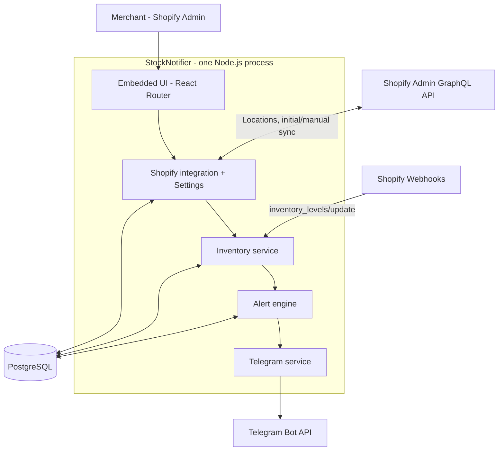
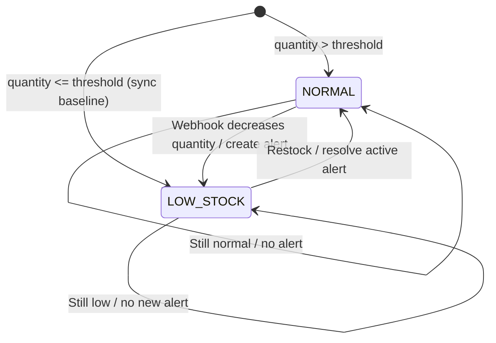
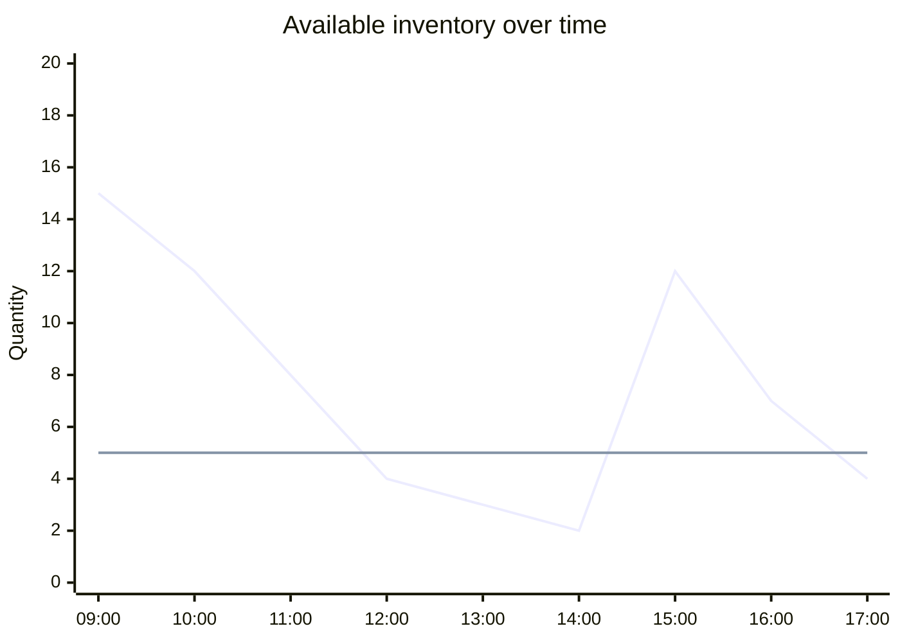
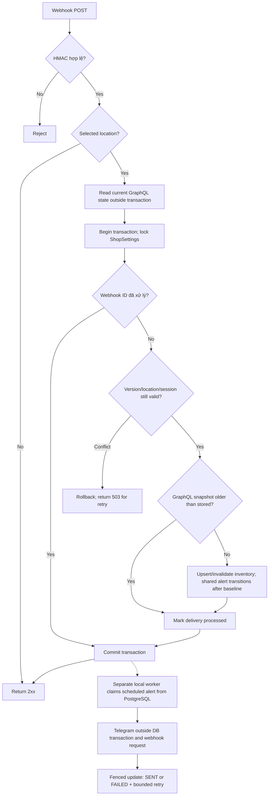

# StockNotifier — Technical Architecture

Phạm vi: [PRD.md](PRD.md). Schema: [DATABASE.md](DATABASE.md). Đây là **modular monolith**, một codebase Node.js và một PostgreSQL. Bước 8 bổ sung worker local dùng chung code/database để gửi Telegram bền vững; không thêm queue service hoặc scheduler ngoài.

## 1. Stack & conventions

- **Shopify official React Router app template**, TypeScript strict, React, App Bridge và UI components theo template thực tế; Node.js phiên bản tương thích template.
- **Shopify Admin GraphQL API `2026-07`**, webhook HTTPS, auth/session do Shopify package cung cấp. Runtime (`app/shopify.server.ts`), codegen (`.graphqlrc.ts`) dùng `ApiVersion.July26`; `[webhooks].api_version` trong `shopify.app.toml` là `2026-07`.
- **Prisma + PostgreSQL** cho session, settings, inventory, alerts và webhook deduplication.
- **Telegram Bot API** qua server, **Vitest** cho unit/integration tests.
- Dùng `shopify app dev` + tunnel HTTPS do Shopify CLI thiết lập để Shopify gửi webhook về app local. Không cần hosting production.

## 2. Sơ đồ hệ thống



Webhook route độc lập, **không** nằm dưới embedded-app layout. Các routes xác thực shop trước khi truy cập dữ liệu. Services xử lý logic, route chỉ làm request/response. Giữ nguyên cấu trúc template; không bắt buộc tạo một cây thư mục phức tạp từ đầu.

### Cấu trúc thư mục định hướng

```text
stock-notifier/
├── AGENTS.md
├── docs/
│   ├── PRD.md
│   ├── ARCHITECTURE.md
│   ├── DATABASE.md
│   ├── IMPLEMENTATION_PLAN.md
│   └── ACCEPTANCE_CRITERIA.md
└── stock-notifier-app/
    ├── app/
    │   ├── modules/
    │   │   ├── shopify/graphql/
    │   │   ├── inventory/
    │   │   │   ├── inventory.service.ts
    │   │   │   ├── inventory-sync.service.ts
    │   │   │   └── inventory.repository.ts
    │   │   ├── alerts/alert.service.ts
    │   │   ├── notifications/telegram.service.ts
    │   │   └── settings/settings.service.ts
    │   ├── routes/
    │   │   ├── app._index.tsx
    │   │   ├── app.inventory.tsx
    │   │   ├── app.settings.tsx
    │   │   └── webhooks.inventory-levels-update.tsx
    │   ├── shopify.server.ts
    │   ├── db.server.ts
    │   └── routes.ts
    ├── prisma/
    │   ├── schema.prisma
    │   └── migrations/
    ├── package.json
    └── shopify.app.toml
```

Đây là **định hướng các file sẽ bổ sung**, không phải cây thư mục đã tồn tại hay yêu cầu tạo đủ từ ngày đầu. Các route và tên file cuối cùng phải phù hợp với `app/routes.ts` và conventions của phiên bản template đang cài. Giữ nguyên những route auth/webhook và generated files sẵn có.

## 3. Shopify integration

**M1 multi-location foundation:** thêm `MonitoredLocation` theo `(shopDomain, locationGid)`, chưa đổi Shopify API/UI/services. Các trường location/lastSyncedAt và lock `ShopSettings.updatedAt` vẫn là nguồn runtime. Version mới là PostgreSQL BIGINT/Prisma BigInt (default 0), độc lập timestamp, dành cho optimistic checks dưới location lock ở phase sau; M1 chưa dual-write hoặc dùng version này. Backfill chỉ là ảnh chụp lúc migration, không tự cập nhật theo sync/đổi location tiếp theo. M2 phải xác minh active qua Shopify và chuyển writers/readers/locking đồng bộ trước khi sử dụng dữ liệu mới.

- Tối thiểu cần `read_inventory`, `read_products`. Xác minh fields/scopes/webhook trên **`2026-07`** và thêm `read_locations` **chỉ nếu** truy vấn thực tế yêu cầu. Không xin write scopes.
- GraphQL: lấy active locations; lấy tracked inventory items, SKU, `available` tại selected location và toàn bộ `InventoryItem.variants` (kèm product metadata). Xử lý cursor pagination cả items và variants, variables và GraphQL errors; không dùng singular `variant` để giả định quan hệ 1:1.
- Lưu `shopDomain` từ session đã xác thực, `locationGid` từ selected location; không tin shop ID do client truyền.
- Một snapshot/alert cycle theo `shop + location + inventoryItem`; lưu metadata variants trong `variants Json`, không tạo snapshot hay message riêng cho từng variant. Đọc `InventoryLevel.updatedAt` để chống stale writes.
- Webhook `inventory_levels/update`, `connect`, `disconnect` dùng cùng route `/webhooks/inventory`. Giữ chính xác legacy ID 64-bit khi chuyển sang GID; không cắt query string của level GID. Dùng webhook làm tín hiệu đọc lại `InventoryItem.inventoryLevel(locationId)` và metadata/variants qua GraphQL; không ghi quantity từ payload. Disconnect không có `updated_at`, nên cũng đọc lại để tránh vô hiệu hóa level đã reconnect. Không suy diễn item không tracked thành quantity 0.
- Webhook không nhất thiết mang product metadata: với inventory item chưa có trong snapshot, bổ sung metadata bằng GraphQL hoặc để lần sync kế tiếp xử lý; không hiển thị bản ghi thiếu định danh giả.
- Khai báo subscription theo cấu hình app/template được tạo, bao gồm webhook uninstall bắt buộc nếu template yêu cầu. Dùng `authenticate.webhook(request)` để kiểm chữ ký. Không dùng auth của UI trên webhook route.
- Shopify có thể gửi trùng, sai thứ tự hoặc bị lỡ webhook; hỗ trợ **Sync Now** để đối soát thủ công.

Tài liệu API chính thức: [React Router package](https://shopify.dev/docs/api/shopify-app-react-router/latest), [InventoryItem 2026-07](https://shopify.dev/docs/api/admin-graphql/2026-07/objects/InventoryItem), [InventoryLevel 2026-07](https://shopify.dev/docs/api/admin-graphql/2026-07/objects/InventoryLevel), [Webhooks 2026-07](https://shopify.dev/docs/api/webhooks/2026-07), [Webhook verification](https://shopify.dev/docs/apps/build/webhooks/verify-deliveries), [Telegram Bot API](https://core.telegram.org/bots/api).

### Full Sync và đổi location

- Thu thập kết quả mọi trang vào bộ nhớ cho MVP local; không ghi snapshot hoặc giữ DB transaction trong khi gọi Shopify. Scan lỗi, thiếu trang hoặc GraphQL errors thì bỏ kết quả scan, giữ nguyên snapshots, alerts và `lastSyncedAt` trước đó.
- Scan thành công toàn bộ mới áp dụng trong một transaction: upsert items hợp lệ với `isCurrent = true`, đánh dấu items không còn hợp lệ `isCurrent = false`, resolve active alerts của items đó, đánh giá transition nếu không phải baseline và cập nhật `lastSyncedAt`. Giữ snapshots cũ và lịch sử alert; chỉ gọi Telegram sau commit.
- Trước commit, kiểm tra selected location/baseline vẫn phù hợp; hủy kết quả scan nếu location đã đổi. Dùng cùng cơ chế lock/chống stale với webhook; đối soát các cập nhật đồng thời để scan không ghi đè hoặc vô hiệu hóa snapshot mới hơn.
- Đổi location trong một transaction: resolve active alerts location cũ, đặt snapshots cũ `isCurrent = false`, chuyển location và reset `lastSyncedAt = null`. Initial sync sau đó là baseline mới, kể cả quay lại location cũ; trước khi baseline thành công không đánh giá transition/gửi Telegram tự động.
- UI và threshold evaluation chỉ đọc items `isCurrent = true` tại selected location sau baseline. Một scan thành công với 0 items vẫn cập nhật `lastSyncedAt` và vô hiệu hóa dữ liệu cũ trong scope đó.

## 4. State transition và ví dụ Mermaid

Hàm quyết định: `isLowStock = availableQuantity <= lowStockThreshold`. `OUT_OF_STOCK` là nhãn UI khi quantity bằng 0; business state vẫn là `LOW_STOCK`.



Thay biểu đồ ảnh gốc bằng dữ liệu minh họa dạng Mermaid (đường 1: quantity; đường 2: threshold = 5):



12:00 tạo alert; 13:00–14:00 không gửi lại; 15:00 resolve; 17:00 tạo alert mới.

## 5. Webhook transaction & Telegram



**Quy tắc bắt buộc:**

1. Unique `(shopDomain, webhookId)`; ghi nhận delivery **trong cùng transaction** với inventory và alert. Nếu transaction lỗi, rollback delivery ID để Shopify có thể retry.
2. Lock hàng inventory (hoặc atomic conditional update/serializable retry) khi đánh giá trạng thái; không tạo hai `ACTIVE` alerts do webhook đồng thời.
3. Payload cũ chỉ kích hoạt đối soát GraphQL, không ghi trực tiếp. Snapshot GraphQL cũ hơn `shopifyUpdatedAt` đã lưu bị bỏ qua; timestamp bằng nhau dùng kết quả đọc GraphQL hiện tại. Đọc API ngoài transaction, sau đó lock ShopSettings và kiểm tra lại version/location/session trước commit, kể cả kết quả âm (deleted/disconnected). Mỗi inventory commit tăng `updatedAt` đơn điệu để vô hiệu hóa scan/read đồng thời, không đổi `lastSyncedAt` của full sync. Conflict trả 503 để Shopify retry; thiếu session/settings thì ACK và đối soát thủ công sau khi khôi phục auth. Uninstall xóa session dưới cùng shop lock.
4. Trong transaction tạo alert mới, chỉ lên lịch khi đã có bot token và Chat ID: lưu destination/text bất biến cùng alert. Webhook/sync không gọi hoặc chờ Telegram. Worker local poll PostgreSQL, claim bằng `FOR UPDATE SKIP LOCKED`, lease 30 giây và token riêng; gửi bằng native fetch ngoài transaction (timeout 2 giây), chỉ ghi SENT/notifiedAt sau API `ok:true`. Telegram lỗi không rollback inventory/webhook.
5. Tối đa 3 lần claim/thử; retry lỗi transport, HTTP 429/5xx và API lỗi tạm thời sau 5/30 giây hoặc `retry_after` dài hơn. Lease/retry/finalize dùng đồng hồ PostgreSQL, token chặn stale worker; lease hết hạn được claim lại, hết lượt thành FAILED. Alert lịch sử hoặc tạo khi thiếu cấu hình có lịch NULL, không gửi hàng loạt khi cấu hình sau đó. Worker kiểm tra ACTIVE/current/selected location/session/Chat ID; job không còn hợp lệ bị hủy thành FAILED. Crash hoặc timeout sau khi Telegram đã nhận nhưng trước khi DB ghi SENT có thể gây gửi lại; không cam kết exactly-once. Thay cấu hình/resolve không thu hồi được HTTP send đang diễn ra.
6. **Initial sync** khi `lastSyncedAt = null` chỉ thiết lập baseline, không tạo alert/gửi Telegram. **Sync Now tiếp theo** dùng chung Alert Engine với webhook; item mới hoặc trở lại current chỉ nhận baseline. Đổi threshold rebase `isLowStock` của items current sau baseline và resolve alerts không còn hợp lệ, không tạo alert mới. Mọi inventory/settings writer phải lock cùng hàng `ShopSettings`; sync kiểm tra lại `updatedAt` trước commit để hủy scan dùng cấu hình cũ. Inventory và alert transitions nằm trong cùng transaction; partial unique ACTIVE index là chốt chống trùng. Full sync và đổi location tuân theo mục 3.

Webhook handler chỉ sử dụng source shop và event data đã xác thực. Secrets (`SHOPIFY_API_SECRET`, token Telegram, DB URL) trong `.env` local, không commit Git. Việc kiểm chứng behavior nằm trong [ACCEPTANCE_CRITERIA.md](ACCEPTANCE_CRITERIA.md).
