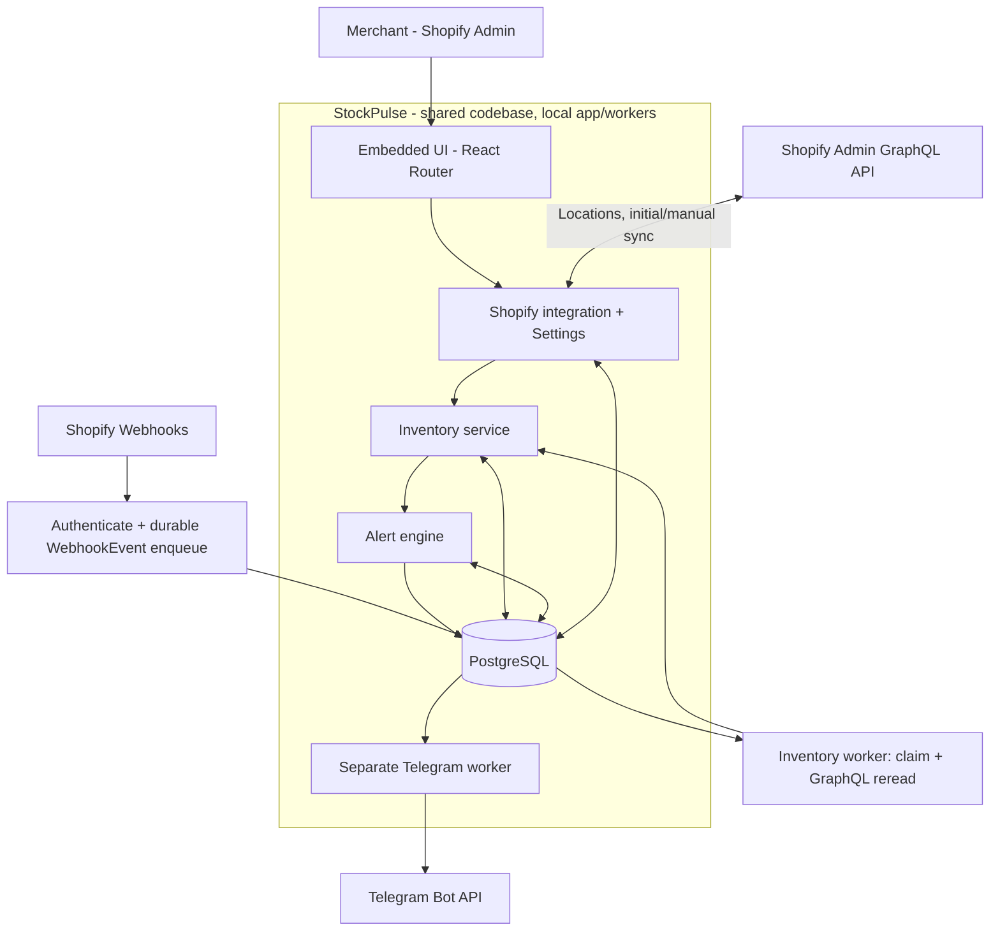
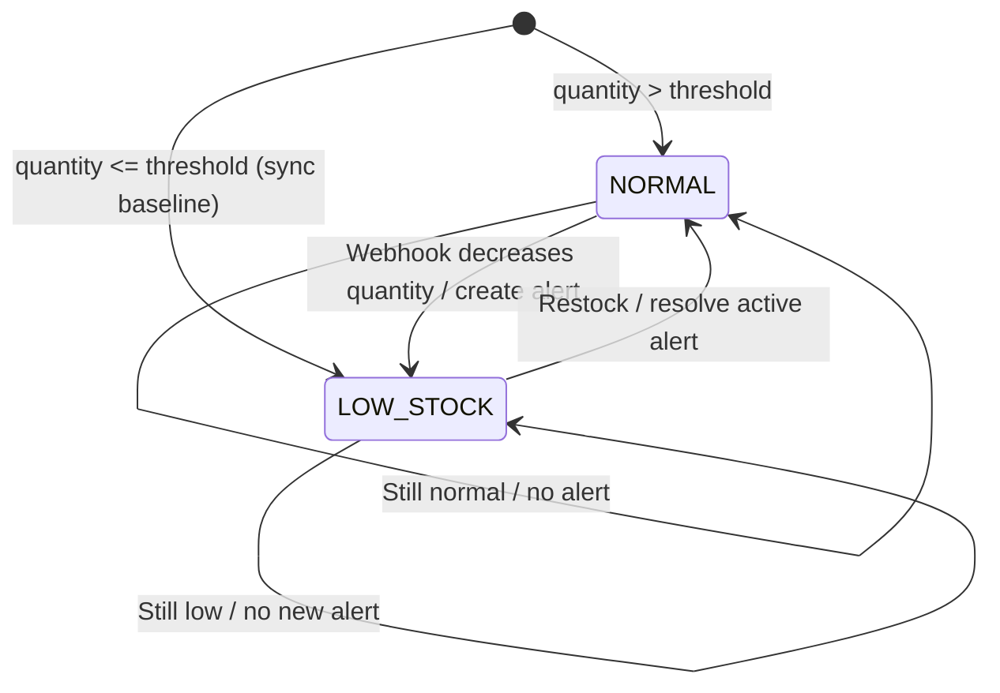
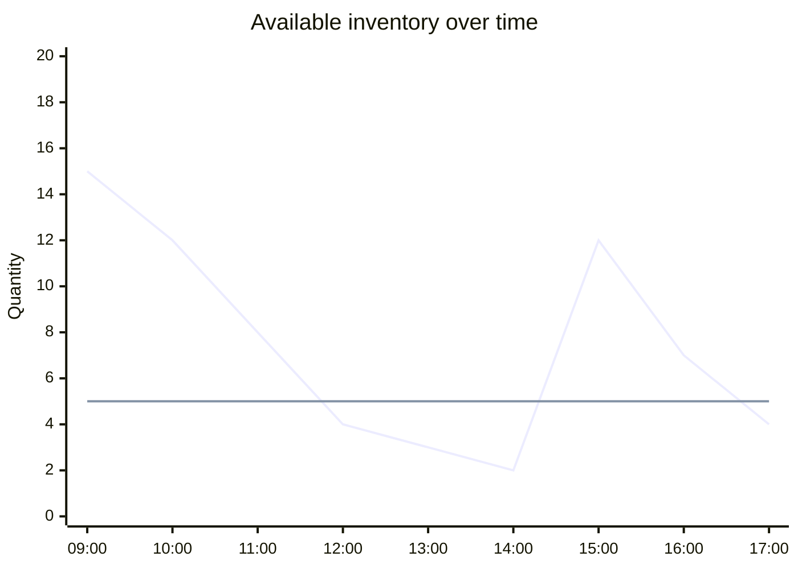
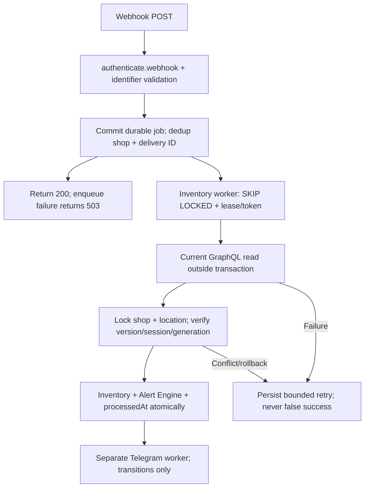

# StockNotifier — Technical Architecture

Phạm vi: [PRD.md](PRD.md). Schema: [DATABASE.md](DATABASE.md). Đây là **modular monolith**, một codebase Node.js và một PostgreSQL. Bước 8 bổ sung worker local dùng chung code/database để gửi Telegram bền vững; không thêm queue service hoặc scheduler ngoài.

## 1. Stack & conventions

**M4:** HTML reference mới nhất trong app root là source UI; dùng Polaris 2/AppProvider/App Bridge có sẵn. Dashboard `/app`, history `/app/alerts` đọc PostgreSQL qua authenticated loaders; Settings `/app/settings` giữ services hiện tại. Module `dashboard/` tách read repository, URL filters, components/CSS. Không inventory GraphQL scan trong Dashboard loader. Filter GET chỉ đọc, không gọi selection/sync/Alert Engine. Settings Refresh locations là action discovery tường minh, Sync all locations dùng action sync hiện có.

- **Shopify official React Router app template**, TypeScript strict, React, App Bridge và UI components theo template thực tế; Node.js phiên bản tương thích template.
- **Shopify Admin GraphQL API `2026-07`**, webhook HTTPS, auth/session do Shopify package cung cấp. Runtime (`app/shopify.server.ts`), codegen (`.graphqlrc.ts`) dùng `ApiVersion.July26`; `[webhooks].api_version` trong `shopify.app.toml` là `2026-07`.
- **Prisma + PostgreSQL** cho session, settings, inventory, alerts và webhook deduplication.
- **Telegram Bot API** qua server, **Vitest** cho unit/integration tests.
- Dùng `shopify app dev` + tunnel HTTPS do Shopify CLI thiết lập để Shopify gửi webhook về app local. Không cần hosting production.

## 2. Sơ đồ hệ thống



Webhook route độc lập, **không** nằm dưới embedded-app layout. Các routes xác thực shop trước khi truy cập dữ liệu. Services xử lý logic, route chỉ làm request/response. Giữ nguyên cấu trúc template; không bắt buộc tạo một cây thư mục phức tạp từ đầu.

### Cấu trúc thư mục định hướng

```text
stock-notifier/
├── AGENTS.md
├── docs/
│   ├── PRD.md
│   ├── ARCHITECTURE.md
│   ├── DATABASE.md
│   ├── IMPLEMENTATION_PLAN.md
│   └── ACCEPTANCE_CRITERIA.md
└── stock-notifier-app/
    ├── app/
    │   ├── modules/
    │   │   ├── shopify/graphql/
    │   │   ├── inventory/
    │   │   │   ├── inventory.service.ts
    │   │   │   ├── inventory-sync.service.ts
    │   │   │   └── inventory.repository.ts
    │   │   ├── alerts/alert.service.ts
    │   │   ├── notifications/telegram.service.ts
    │   │   └── settings/settings.service.ts
    │   ├── routes/
    │   │   ├── app._index.tsx
    │   │   ├── app.inventory.tsx
    │   │   ├── app.settings.tsx
    │   │   └── webhooks.inventory-levels-update.tsx
    │   ├── shopify.server.ts
    │   ├── db.server.ts
    │   └── routes.ts
    ├── prisma/
    │   ├── schema.prisma
    │   └── migrations/
    ├── package.json
    └── shopify.app.toml
```

Đây là **định hướng các file sẽ bổ sung**, không phải cây thư mục đã tồn tại hay yêu cầu tạo đủ từ ngày đầu. Các route và tên file cuối cùng phải phù hợp với `app/routes.ts` và conventions của phiên bản template đang cài. Giữ nguyên những route auth/webhook và generated files sẵn có.

## 3. Shopify integration

**M3 runtime:** worker local dùng `unauthenticated.admin(shop)` với shop từ Session offline đã lưu, discovery đầy đủ bằng getLocations rồi reconcile MonitoredLocation trong transaction. Mỗi location scan ngoài transaction, xác minh active lại sau scan, commit riêng. Location/baseline/version lấy từ MonitoredLocation; các trường location legacy chỉ giữ preference. Webhook định tuyến theo payload đã xác thực và MonitoredLocation, kể cả trước discovery đầy đủ đầu tiên.

Lock order: shop trước, location sau. Sync giữ `FOR SHARE` trên ShopSettings để đọc cấu hình ổn định, `FOR UPDATE` trên một MonitoredLocation và kiểm tra BigInt version; mỗi inventory writer tăng version của location. Threshold/discovery/uninstall lấy shop `FOR UPDATE`; threshold lock locations theo GID. Thay threshold/Chat ID tăng shop.updatedAt để hủy scan cấu hình cũ. Discovery đồng thời kiểm tra cả updatedAt và locationsDiscoveredAt; không giữ transaction khi gọi Shopify.

Worker inventory tái sử dụng entry/build hiện có ở mode `--inventory`, với hai vòng được await: drain WebhookEvent và reconciliation tuần tự shops/locations. Không GraphQL trong HTTP webhook. Interval/error backoff mặc định 60 giây, cấu hình INVENTORY_RECONCILE_INTERVAL_MS/INVENTORY_RETRY_BACKOFF_MS (100–3600000 ms). Một lần GraphQL tối đa 3 attempts, conflict scan tối đa 2; lỗi A không chặn B. Restart dùng persisted jobs/baseline/timestamps. Polling phục hồi current state, không tái dựng mọi transition trung gian khi offline.

- Scopes: `read_inventory`, `read_products`, `read_locations`. Topics lifecycle và location(id) đã đối chiếu tài liệu **2026-07**; không xin write scopes.
- GraphQL: lấy active locations; tracked inventory items, SKU, `available` tại từng monitored active location và toàn bộ `InventoryItem.variants`. Pagination cả items và variants, variables và GraphQL errors; không giả định quan hệ 1:1.
- Lưu shop từ session/webhook đã xác thực, location từ MonitoredLocation hoặc payload đã xác thực; không tin shop do client truyền.
- Một snapshot/alert cycle theo `shop + location + inventoryItem`; lưu metadata variants trong `variants Json`, không tạo snapshot hay message riêng cho từng variant. Đọc `InventoryLevel.updatedAt` để chống stale writes.
- Webhook `inventory_levels/update`, `connect`, `disconnect` dùng cùng route `/webhooks/inventory`. Giữ chính xác legacy ID 64-bit khi chuyển sang GID; không cắt query string của level GID. Dùng webhook làm tín hiệu đọc lại `InventoryItem.inventoryLevel(locationId)` và metadata/variants qua GraphQL; không ghi quantity từ payload. Disconnect không có `updated_at`, nên cũng đọc lại để tránh vô hiệu hóa level đã reconnect. Không suy diễn item không tracked thành quantity 0.
- Webhook không nhất thiết mang product metadata: với inventory item chưa có trong snapshot, bổ sung metadata bằng GraphQL hoặc để lần sync kế tiếp xử lý; không hiển thị bản ghi thiếu định danh giả.
- Khai báo subscription theo cấu hình app/template được tạo, bao gồm webhook uninstall bắt buộc nếu template yêu cầu. Dùng `authenticate.webhook(request)` để kiểm chữ ký. Không dùng auth của UI trên webhook route.
- Shopify có thể gửi trùng, sai thứ tự hoặc bị lỡ webhook; hỗ trợ **Sync Now** để đối soát thủ công.

Tài liệu API chính thức: [React Router package](https://shopify.dev/docs/api/shopify-app-react-router/latest), [InventoryItem 2026-07](https://shopify.dev/docs/api/admin-graphql/2026-07/objects/InventoryItem), [InventoryLevel 2026-07](https://shopify.dev/docs/api/admin-graphql/2026-07/objects/InventoryLevel), [Webhooks 2026-07](https://shopify.dev/docs/api/webhooks/2026-07), [Webhook verification](https://shopify.dev/docs/apps/build/webhooks/verify-deliveries), [Telegram Bot API](https://core.telegram.org/bots/api).

### Full Sync và đổi location

- Thu thập kết quả mọi trang vào bộ nhớ cho MVP local; không ghi snapshot hoặc giữ DB transaction trong khi gọi Shopify. Scan lỗi, thiếu trang hoặc GraphQL errors thì bỏ kết quả scan, giữ nguyên snapshots, alerts và `lastSyncedAt` trước đó.
- Scan thành công toàn bộ mới commit mỗi location: upsert current snapshots, vô hiệu items thiếu/resolve alerts, áp dụng Alert Engine và cập nhật lastSyncedAt/baseline/version riêng. Lỗi A không rollback B. Thiếu available trong scan M2 là lỗi, không biến thành empty scan/zero.
- Trước commit kiểm tra shop config version, location active/version và session offline; hủy stale scans. Webhook dùng cùng location lock/version. Shopify không cung cấp snapshot xuyên pagination; kiểm tra active sau scan và local fencing giảm race, không bảo đảm snapshot remote tuyệt đối.
- Đổi preference legacy không tác động monitored data. Lifecycle đã xác minh hoặc discovery toàn bộ thành công mới đánh dấu inactive, vô hiệu snapshots và resolve alerts; lỗi discovery không áp dụng kết quả một phần.
- Threshold tính lại current items thuộc tất cả monitored active locations, tạo THRESHOLD_CHANGE khi mới low, resolve khi hết low. Không phát Telegram riêng lẻ. Empty scan đã xác minh vẫn cleanup đúng location.

## 4. State transition và ví dụ Mermaid

Hàm quyết định: `isLowStock = availableQuantity <= lowStockThreshold`. `OUT_OF_STOCK` là nhãn UI khi quantity bằng 0; business state vẫn là `LOW_STOCK`.



Thay biểu đồ ảnh gốc bằng dữ liệu minh họa dạng Mermaid (đường 1: quantity; đường 2: threshold = 5):



12:00 tạo alert; 13:00–14:00 không gửi lại; 15:00 resolve; 17:00 tạo alert mới.

## 5. Webhook transaction & Telegram



**Quy tắc bắt buộc:**

1. Unique `(shopDomain, webhookId)`; Event-Id chỉ correlation. HTTP commit pending job rồi ACK; không GraphQL/full sync/Telegram. Worker claim SKIP LOCKED, lease 5 phút/token dùng đồng hồ PostgreSQL. Inventory/alerts + processedAt commit atomic. Retry tối đa 8 claims, exponential từ WEBHOOK_RETRY_BASE_MS (default 5000 ms), cap 5 phút. Hết lượt giữ processedAt null/result retry_exhausted; reconciliation phục hồi current state, không giả success cho job lỗi.
2. Lock hàng inventory (hoặc atomic conditional update/serializable retry) khi đánh giá trạng thái; không tạo hai `ACTIVE` alerts do webhook đồng thời.
3. Payload chỉ kích hoạt GraphQL reread; snapshot cũ hơn shopifyUpdatedAt bị bỏ qua. API ngoài transaction, commit lock shop rồi location, kiểm tra version/session/generation kể cả kết quả âm. Inventory commit tăng version location, không đổi lastSyncedAt full sync. Conflict/API/session lỗi giữ job retryable. Event tới trước baseline sẽ chạy baseline rồi đọc lại item. Uninstall xóa session dưới cùng shop lock.
4. Trong transaction tạo alert mới, chỉ lên lịch khi đã có bot token và Chat ID: lưu destination/text bất biến cùng alert. Webhook/sync không gọi hoặc chờ Telegram. Worker local poll PostgreSQL, claim bằng `FOR UPDATE SKIP LOCKED`, lease 30 giây và token riêng; gửi bằng native fetch ngoài transaction (timeout 2 giây), chỉ ghi SENT/notifiedAt sau API `ok:true`. Telegram lỗi không rollback inventory/webhook.
5. Tối đa 3 lần claim/thử; retry lỗi transport, HTTP 429/5xx và API lỗi tạm thời sau 5/30 giây hoặc `retry_after` dài hơn. Lease/retry/finalize dùng đồng hồ PostgreSQL, token chặn stale worker; lease hết hạn được claim lại, hết lượt thành FAILED. Alert lịch sử hoặc tạo khi thiếu cấu hình có lịch NULL, không gửi hàng loạt khi cấu hình sau đó. Worker kiểm tra ACTIVE/current/monitored active location/session/Chat ID; job không còn hợp lệ bị hủy thành FAILED. Crash hoặc timeout sau khi Telegram đã nhận nhưng trước khi DB ghi SENT có thể gây gửi lại; không cam kết exactly-once. Thay cấu hình/resolve không thu hồi được HTTP send đang diễn ra.
6. **M2 baseline/catch-up:** Alert Engine nhận origin BASELINE để tạo ACTIVE cho low items, dùng partial unique index/skipDuplicates giữ nguyên ACTIVE cũ. baselineAlertsCompletedAt chỉ ghi cùng successful full-sync transaction, độc lập baselineCompletedAt M1. BASELINE/THRESHOLD_CHANGE không có lịch gửi riêng; worker chỉ claim INVENTORY_TRANSITION và không giả SENT/FAILED cho alerts chờ M4. Các jobs transition trước migration giữ origin INVENTORY_TRANSITION, nguyên retry/lease metadata. Trước discovery thành công đầu tiên, đường compatibility legacy vẫn giữ policy cũ để tránh đổi dữ liệu trước khi xác minh locations.

Webhook handler chỉ sử dụng source shop và event data đã xác thực. Secrets (`SHOPIFY_API_SECRET`, token Telegram, DB URL) trong `.env` local, không commit Git. Việc kiểm chứng behavior nằm trong [ACCEPTANCE_CRITERIA.md](ACCEPTANCE_CRITERIA.md).

### M4 digest protocol

Alert Engine giữ transitions M3. Sau khi insert alert mới thành công, cùng transaction gắn digestId chỉ cho BASELINE/THRESHOLD_CHANGE đủ Bot Token/Chat ID. Không scan historical PENDING. Baseline dùng advisory lock theo shop (sau shop/location locks) để gom commits các locations trong cửa sổ cố định 30 giây; membership đóng khi worker claim. Threshold operation có UUID tạo một lần trước transaction, batchKey duy nhất theo shop; retry worker không tạo batch khác. Nếu operation rollback, alert/batch/membership cùng rollback.

NotificationDigest lưu origin/destination, old/new threshold, expected location coverage, timestamps và delivery metadata. Worker Telegram hiện tại xử lý immediate transition rồi digest; claim lấy shop write lock trước batch SKIP LOCKED, lease 30 giây/token, đồng hồ PostgreSQL. Tối đa 3 claims; retry 5/30 giây hoặc Telegram retry_after lớn hơn. Không giữ transaction khi gọi Telegram. Finalize fenced transaction cập nhật batch và eligible alert members atomic chỉ sau ok:true. API lỗi không rollback inventory; DB finalize lỗi giữ lease để restart phục hồi. Lease hết lượt FAILED; stale worker không được finalize.

Trước mỗi attempt, đọc lại active/current/low/baseline/session/destination. Resolved members không xuất hiện như đang low; empty/ineligible batch CANCELLED, alerts không được giả SENT/FAILED. Message deterministic theo location/item/id, plain text không parse_mode; tổng số bao gồm tất cả eligible members, chỉ truncate chi tiết và nêu số còn lại. Không chia nhiều phần. Có khoảng race giữa eligibility read và HTTP send; resolve/config edit không thu hồi được send đang diễn ra. Crash sau khi Telegram nhận nhưng trước DB commit có thể gửi lại.

Dashboard dùng read-only RepeatableRead transaction để counts/page nhất quán; locations lỗi vẫn hiển thị last successful snapshots nếu baseline đã hoàn tất, cùng lỗi sync/mốc attempt riêng. LastSyncError không thay baseline/quantity/version; failed stale attempt không được ghi đè metadata của commit mới hơn. Không giả worker Running vì chưa có heartbeat; UI ghi rõ chưa có liveness telemetry.

### M3 location lifecycle

Cả hai TOML giữ webhook hệ thống, thêm locations/create, activate, update, deactivate, delete vào /webhooks/inventory. Worker dùng location(id) xác minh store/name/isActive. Rename giữ baseline/quantity/alerts. Deactivate đặt isCurrent=false và resolve reason LOCATION_DEACTIVATED, tăng generation/version để hủy scan/job chu kỳ cũ. Reactivate reset baseline markers/lastSyncedAt rồi baseline mới, origin BASELINE. Delete lấy ID payload, ghi tombstone trong enqueue transaction để fence scan; cleanup trong worker, không cần GraphQL đọc location đã xóa. Tombstone không tự resurrect.

Lifecycle metadata và baseline là các bước idempotent; job chỉ complete sau baseline thành công. Discovery/threshold/lifecycle lấy shop write lock; inventory lấy shop share rồi location write lock. Captured version và shop.updatedAt chống stale metadata/discovery. Không giữ transaction khi gọi API. Job quá lease không được finalize; inventory/alert rollback nếu token/lease không hợp lệ.
