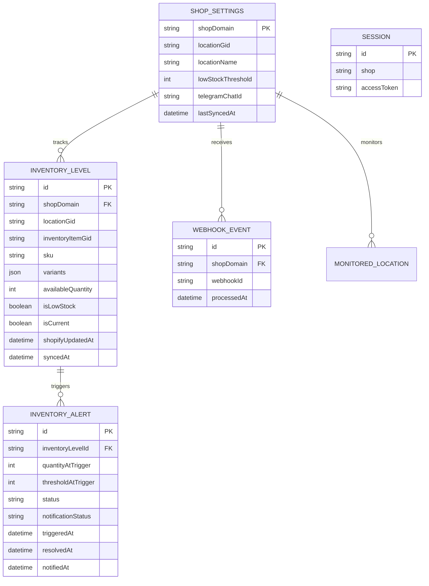

# StockNotifier — Database Design (Prisma + PostgreSQL)

Một database phục vụ Shopify sessions và năm bảng nghiệp vụ sau M1 (thêm `MonitoredLocation`). Tên cột/model chi tiết có thể theo naming conventions của template; các **ràng buộc và quan hệ** dưới đây là yêu cầu.

## 1. ERD

`SESSION` do official Shopify template/adapter quản lý. Không tự tạo quan hệ hoặc thay các trường bảo mật của Session chỉ để khớp ERD minh họa.

## 2. Bảng và constraints

| Model | Những field và constraint bắt buộc |
| --- | --- |
| `ShopSettings` | `shopDomain` PK; legacy preference `locationGid?`, `locationName?`, `lastSyncedAt?` (không quyết định monitoring M3); `telegramChatId?`, `locationsDiscoveredAt?`; `lowStockThreshold Int @default(5)` với kiểm tra `>= 0`; timestamps tạo/sửa |
| `MonitoredLocation` | PK `(shopDomain, locationGid)`; `shopDomain` FK tới ShopSettings (`RESTRICT` delete); `locationName?`; `isActive Boolean?` (`null` = chưa xác minh Shopify, `false` = đã xác minh inactive); `syncStatus = PENDING/READY` default PENDING; `baselineCompletedAt?`, `baselineAlertsCompletedAt?`, `lastSyncedAt?`; `version BigInt` default 0; `createdAt`, `updatedAt`; timestamps `Timestamptz(3)`; không thêm index ngoài PK |
| `InventoryLevel` | `id` PK; `shopDomain` FK; `locationGid`, `inventoryItemGid`, `variants Json`, `availableQuantity`, `isLowStock`, `isCurrent Boolean @default(true)`, `syncedAt`; `sku?`, `shopifyUpdatedAt?`; `@@unique([shopDomain, locationGid, inventoryItemGid])` |
| `InventoryAlert` | `id` PK; `inventoryLevelId` FK; `quantityAtTrigger`, `thresholdAtTrigger`; `status = ACTIVE/RESOLVED`, `notificationStatus = PENDING/SENT/FAILED`; `triggeredAt`, `resolvedAt?`, `notifiedAt?`; notification metadata: `notificationChatId?`, `notificationText?`, `notificationAttempts` default 0, `notificationNextAttemptAt?` (index), `notificationLeaseUntil?`, `notificationLeaseToken?`, `notificationError?` |
| `WebhookEvent` | `id` PK; `shopDomain` FK; `webhookId`; `processedAt?`; `@@unique([shopDomain, webhookId])`; M3 bổ sung job metadata bên dưới |

M2 thêm `ShopSettings.locationsDiscoveredAt?` làm mốc cutover/optimistic discovery token và `InventoryAlert.origin` enum BASELINE/INVENTORY_TRANSITION/THRESHOLD_CHANGE (default INVENTORY_TRANSITION cho toàn bộ alerts cũ, giữ delivery metadata). `MonitoredLocation.baselineAlertsCompletedAt?` đánh dấu catch-up đã commit, không nhầm baseline M1 với policy mới.

M3 migration `20261102020000_durable_location_webhooks` mở rộng bảng hiện có, không tạo bảng mới:

- MonitoredLocation: `generation BigInt @default(0)` đổi khi chuyển active/inactive; `deletedAt?` là tombstone vĩnh viễn. `version` vẫn tăng khi inventory/metadata đổi để fence scans.
- InventoryAlert: `resolutionReason?` enum STOCK_RECOVERED/INVENTORY_UNAVAILABLE/LOCATION_DEACTIVATED/LOCATION_DELETED/MONITORING_STOPPED. Alerts lịch sử giữ null, không đoán lý do cũ.
- WebhookEvent: `receivedAt`, `topic?`, `eventId?`, `locationGid?`, `inventoryItemGid?`, `generation?`, `attempts` default 0, `nextAttemptAt?` (index), `leaseUntil?`, `leaseToken?`, `lastError?`, `result?`. Pending/retry có processedAt null; chỉ completion mới ghi processedAt. Event cũ giữ nguyên processedAt, không tự enqueue lại.
- Retry tối đa 8 claims, lease 5 phút/token; hết lượt giữ `processedAt=null`, `result=retry_exhausted`, không ghi thành công giả. Telegram delivery metadata và Sessions không đổi.

InventoryLevel giữ nguyên composite unique theo shop/location/item, không thêm FK tới MonitoredLocation vì còn inventory lịch sử. Sau cutover, monitoring lấy MonitoredLocation active; preference/lastSyncedAt legacy không còn là source sync. M1 backfill dưới đây là hành vi lịch sử của migration, không phải runtime M2.

Backfill M1 chỉ INSERT khi `ShopSettings.locationGid IS NOT NULL`, giữ nguyên GID/name/timestamps. Nếu `lastSyncedAt` có giá trị: sao chép sang `baselineCompletedAt` và `lastSyncedAt`, đặt READY (baseline từng hoàn tất, không khẳng định Shopify hiện active). Nếu null: PENDING và hai mốc null. `isActive` luôn null khi backfill, version 0; `ON CONFLICT DO NOTHING` giữ bản ghi đã có. Ba trường legacy trên ShopSettings tiếp tục được runtime sử dụng. Migration additive/transactional không đổi bảng/index/dữ liệu cũ, không gọi API hoặc gửi Telegram. M1 không có SYNCING/FAILED vì chưa có location sync runtime.

`sku` thuộc Inventory Item. `variants` là mảng JSON có thể chứa nhiều phần tử `{ variantGid, variantTitle, productGid, productTitle }`; các GID là string. Metadata product/variant nằm trong mảng này, không có một bộ cột singular đại diện cho toàn item. Lấy đủ pagination của quan hệ `InventoryItem.variants` theo Shopify API `2026-07`.

## 3. Data invariants

1. Một `inventoryItemGid` tại một `shop + location` chỉ có một snapshot, dù có nhiều variants trong JSON. KPI, quantity và alert tính theo item; sync lặp không tạo row trùng.
2. Một InventoryLevel có nhiều alert theo thời gian nhưng **tối đa một ACTIVE alert**. Bảo vệ bằng transaction/row lock **và** partial unique index PostgreSQL trên `inventoryLevelId WHERE status = 'ACTIVE'` (tạo bằng migration SQL nếu Prisma schema chưa hỗ trợ partial index).
3. Dedup bằng `(shopDomain, webhookId)`; Event-Id chỉ dùng correlation. HTTP commit job trước khi ACK; inventory/alert và completion của inventory job cùng transaction. Lỗi rollback completion, job còn bền vững để retry. Lifecycle metadata/baseline là các bước idempotent; chỉ complete job khi hoàn tất. Token/lease chặn stale worker.
4. `shopifyUpdatedAt` chống stale writes; `syncedAt` là thời điểm app lưu. Khác shop hoặc location không được ảnh hưởng nhau.
5. `quantity = 0` khác với `quantity` chưa có/null. Không tạo bản ghi tồn kho giả để biểu diễn dữ liệu thiếu.
6. Bảo vệ `threshold >= 0` bằng validation (và DB check nếu thuận tiện). `telegramChatId` là setting per shop; `TELEGRAM_BOT_TOKEN` chỉ ở environment server, **không lưu DB**.
7. Bảng `Session` giữ nguyên adapter của official template; đảm bảo kết nối PostgreSQL hoạt động trước khi implement nghiệp vụ.
8. Full Sync chỉ ghi snapshots, `isCurrent`, alert transitions và `lastSyncedAt` trong transaction sau khi scan thành công toàn bộ. Item không còn hợp lệ được đặt `isCurrent = false` và resolve active alert, không xóa snapshot/alert. Scan lỗi không áp dụng kết quả một phần; webhook đồng thời vẫn phải được bảo toàn.
9. Khi đã có active MonitoredLocation, đổi preference legacy không resolve/invalidate/reset monitored data. Discovery chỉ đánh dấu inactive sau khi đọc đủ danh sách active. Deactivate giữ history; reactivate reset baseline và tăng generation; rename không reset. Tombstone chặn mọi scan/job resurrect location đã delete.
10. Threshold dùng rows current thuộc tất cả active monitored locations; Dashboard đa location chờ M4. Sync locks shop FOR SHARE và location FOR UPDATE, kiểm tra shop.updatedAt/location.version rồi tăng version location; không tăng version location khác.

Không thêm bảng notification deliveries, retry jobs hoặc history inventory. Bước 8 thêm các cột delivery ngay trên InventoryAlert: lịch NULL nghĩa là không lên lịch (bao gồm mọi alert cũ), tối đa 3 lần thử, lease 30 giây và token fencing. Alert/job được ghi atomic; destination/text chụp tại trigger, tránh gửi metadata/Chat ID của cấu hình khác. Không thay đổi Session hoặc partial unique ACTIVE index. Xem transaction và retry giới hạn tại [ARCHITECTURE.md](ARCHITECTURE.md).
