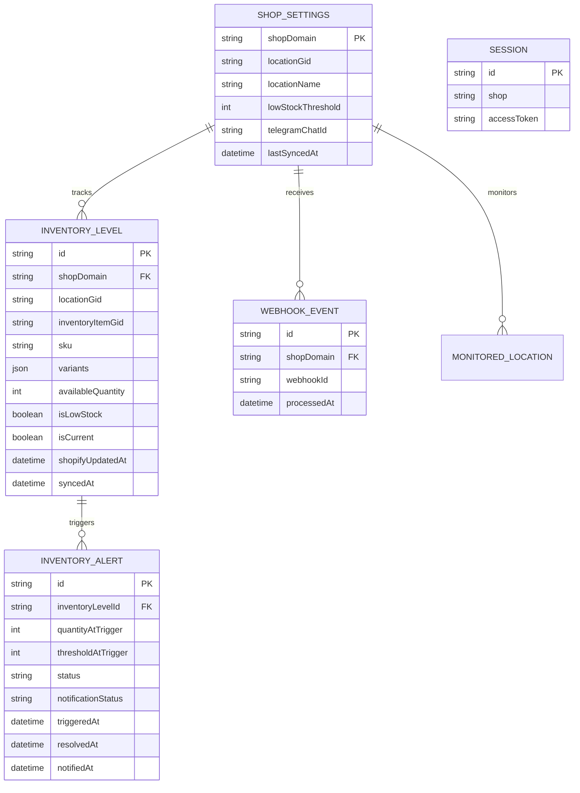

# StockNotifier — Database Design (Prisma + PostgreSQL)

Một database phục vụ Shopify sessions và năm bảng nghiệp vụ sau M1 (thêm `MonitoredLocation`). Tên cột/model chi tiết có thể theo naming conventions của template; các **ràng buộc và quan hệ** dưới đây là yêu cầu.

## 1. ERD

`SESSION` do official Shopify template/adapter quản lý. Không tự tạo quan hệ hoặc thay các trường bảo mật của Session chỉ để khớp ERD minh họa.

## 2. Bảng và constraints

| Model | Những field và constraint bắt buộc |
| --- | --- |
| `ShopSettings` | `shopDomain` PK; `locationGid?`, `locationName?`, `telegramChatId?`, `lastSyncedAt?`; mốc sync chỉ cập nhật sau full scan và transaction thành công, reset `null` khi đổi location; `lowStockThreshold Int @default(5)` với kiểm tra `>= 0`; timestamps tạo/sửa |
| `MonitoredLocation` (M1) | PK `(shopDomain, locationGid)`; `shopDomain` FK tới ShopSettings (`RESTRICT` delete); `locationName?`; `isActive Boolean?` (`null` = chưa xác minh Shopify, `false` = đã xác minh inactive); `syncStatus = PENDING/READY` default PENDING; `baselineCompletedAt?`, `lastSyncedAt?`; `version BigInt` default 0; `createdAt`, `updatedAt`; timestamps `Timestamptz(3)`; không thêm index ngoài PK |
| `InventoryLevel` | `id` PK; `shopDomain` FK; `locationGid`, `inventoryItemGid`, `variants Json`, `availableQuantity`, `isLowStock`, `isCurrent Boolean @default(true)`, `syncedAt`; `sku?`, `shopifyUpdatedAt?`; `@@unique([shopDomain, locationGid, inventoryItemGid])` |
| `InventoryAlert` | `id` PK; `inventoryLevelId` FK; `quantityAtTrigger`, `thresholdAtTrigger`; `status = ACTIVE/RESOLVED`, `notificationStatus = PENDING/SENT/FAILED`; `triggeredAt`, `resolvedAt?`, `notifiedAt?`; notification metadata: `notificationChatId?`, `notificationText?`, `notificationAttempts` default 0, `notificationNextAttemptAt?` (index), `notificationLeaseUntil?`, `notificationLeaseToken?`, `notificationError?` |
| `WebhookEvent` | `id` PK; `shopDomain` FK; `webhookId`; `processedAt`; `@@unique([shopDomain, webhookId])` |

`InventoryLevel` lưu snapshot của từng item tại từng location **đã từng được chọn**. Trong M1, UI/webhook vẫn chỉ xử lý `ShopSettings.locationGid` hiện tại; chưa giám sát đa location đồng thời. Giữ composite key cũ và chưa thêm FK từ InventoryLevel sang MonitoredLocation: inventory lịch sử có thể chưa có location mới tương ứng. FK mới chỉ dùng shopDomain của chính bản ghi, không có shopId riêng có thể lệch tenant.

Backfill M1 chỉ INSERT khi `ShopSettings.locationGid IS NOT NULL`, giữ nguyên GID/name/timestamps. Nếu `lastSyncedAt` có giá trị: sao chép sang `baselineCompletedAt` và `lastSyncedAt`, đặt READY (baseline từng hoàn tất, không khẳng định Shopify hiện active). Nếu null: PENDING và hai mốc null. `isActive` luôn null khi backfill, version 0; `ON CONFLICT DO NOTHING` giữ bản ghi đã có. Ba trường legacy trên ShopSettings tiếp tục được runtime sử dụng. Migration additive/transactional không đổi bảng/index/dữ liệu cũ, không gọi API hoặc gửi Telegram. M1 không có SYNCING/FAILED vì chưa có location sync runtime.

`sku` thuộc Inventory Item. `variants` là mảng JSON có thể chứa nhiều phần tử `{ variantGid, variantTitle, productGid, productTitle }`; các GID là string. Metadata product/variant nằm trong mảng này, không có một bộ cột singular đại diện cho toàn item. Lấy đủ pagination của quan hệ `InventoryItem.variants` theo Shopify API `2026-07`.

## 3. Data invariants

1. Một `inventoryItemGid` tại một `shop + location` chỉ có một snapshot, dù có nhiều variants trong JSON. KPI, quantity và alert tính theo item; sync lặp không tạo row trùng.
2. Một InventoryLevel có nhiều alert theo thời gian nhưng **tối đa một ACTIVE alert**. Bảo vệ bằng transaction/row lock **và** partial unique index PostgreSQL trên `inventoryLevelId WHERE status = 'ACTIVE'` (tạo bằng migration SQL nếu Prisma schema chưa hỗ trợ partial index).
3. Event dedup bằng `(shopDomain, webhookId)`. Chỉ commit `WebhookEvent` khi inventory/alert tương ứng được commit; không lưu trạng thái `PROCESSING` nằm lại sau lỗi.
4. `shopifyUpdatedAt` chống stale writes; `syncedAt` là thời điểm app lưu. Khác shop hoặc location không được ảnh hưởng nhau.
5. `quantity = 0` khác với `quantity` chưa có/null. Không tạo bản ghi tồn kho giả để biểu diễn dữ liệu thiếu.
6. Bảo vệ `threshold >= 0` bằng validation (và DB check nếu thuận tiện). `telegramChatId` là setting per shop; `TELEGRAM_BOT_TOKEN` chỉ ở environment server, **không lưu DB**.
7. Bảng `Session` giữ nguyên adapter của official template; đảm bảo kết nối PostgreSQL hoạt động trước khi implement nghiệp vụ.
8. Full Sync chỉ ghi snapshots, `isCurrent`, alert transitions và `lastSyncedAt` trong transaction sau khi scan thành công toàn bộ. Item không còn hợp lệ được đặt `isCurrent = false` và resolve active alert, không xóa snapshot/alert. Scan lỗi không áp dụng kết quả một phần; webhook đồng thời vẫn phải được bảo toàn.
9. Đổi location atomically resolve active alerts location cũ, đánh dấu snapshots cũ `isCurrent = false`, chuyển selected location và reset `lastSyncedAt = null`. Lần sync kế tiếp tạo baseline mới, không tạo alert/gửi Telegram, kể cả chọn lại location từng dùng.
10. Dashboard và threshold evaluation chỉ dùng rows `isCurrent = true` của selected location sau baseline; rows lịch sử vẫn giữ FK với alerts.

Không thêm bảng notification deliveries, retry jobs hoặc history inventory. Bước 8 thêm các cột delivery ngay trên InventoryAlert: lịch NULL nghĩa là không lên lịch (bao gồm mọi alert cũ), tối đa 3 lần thử, lease 30 giây và token fencing. Alert/job được ghi atomic; destination/text chụp tại trigger, tránh gửi metadata/Chat ID của cấu hình khác. Không thay đổi Session hoặc partial unique ACTIVE index. Xem transaction và retry giới hạn tại [ARCHITECTURE.md](ARCHITECTURE.md).
