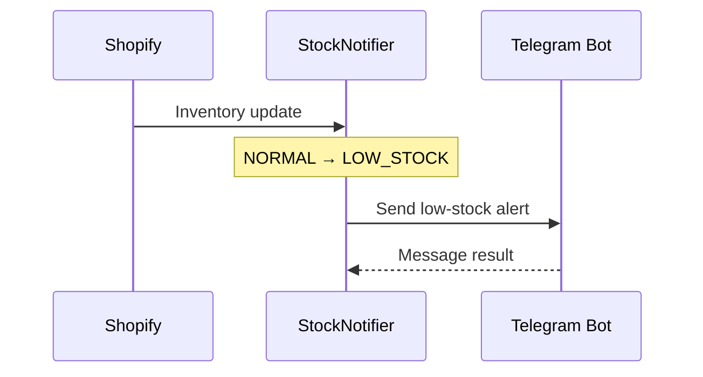

# StockNotifier — MVP Product Requirements

**Mục tiêu:** Shopify embedded app chạy local trên một Development Store trong **3 ngày**. Merchant chọn một location, đồng bộ tồn kho, theo dõi low-stock và nhận Telegram alert. Không yêu cầu public release/deploy production.

Tài liệu liên quan: [Architecture](ARCHITECTURE.md) · [Database](DATABASE.md) · [Implementation Plan](IMPLEMENTATION_PLAN.md) · [Acceptance Criteria](ACCEPTANCE_CRITERIA.md).

## 1. Phạm vi MVP

| Ưu tiên | Chức năng | Kết quả tối thiểu |
| --- | --- | --- |
| P0 | Shopify auth | Cài/mở app trong Development Store, bảo vệ dữ liệu theo shop |
| P0 | Location & sync | Chọn **một location đang theo dõi**; full sync các tracked Inventory Items và `available` quantity |
| P0 | Webhook | Nhận `inventory_levels/update`, xác thực, lọc location, bỏ qua delivery trùng/cũ |
| P0 | Low-stock | Threshold mặc định 5, áp dụng toàn shop; quản lý chuyển trạng thái và active alert |
| P0 | Telegram | Một Bot Token trên server + một Chat ID/shop; test và gửi khi mới vào low-stock |
| P0 | Embedded UI | Dashboard inventory + Settings (location, threshold, Telegram, sync) |
| P1 | Alert history | Danh sách alert, trạng thái `ACTIVE/RESOLVED`, `PENDING/SENT/FAILED` |

Không làm: multi-location monitoring đồng thời, threshold từng variant, tự điều chỉnh stock, purchase order, supplier, AI/forecasting, dashboard analytics, email, custom RBAC, queue/Redis, microservices, hosting production. Dùng auth/session chính thức của Shopify.

## 2. Luồng sử dụng

1. Merchant cài app, chọn location và nhập Telegram Chat ID.
2. Merchant gửi test message, chạy **Sync** lần đầu; app lưu snapshot inventory trong PostgreSQL.
3. Khi inventory thay đổi, Shopify gọi webhook; app cập nhật quantity, đánh giá trạng thái và ghi alert nếu mới chuyển sang low-stock.
4. Telegram nhận thông báo; merchant xem tồn kho và alert trên embedded app.
5. Merchant có thể chạy **Sync** lại để đối soát nếu webhook bị bỏ lỡ.

## 3. Business rules

- **Inventory Item** là đơn vị theo dõi, tính KPI và tạo alert theo `shop + location + inventoryItem`. Một item có thể liên kết nhiều variants; lưu danh sách metadata trong JSON, không nhân bản quantity hay alert theo variant.
- `NORMAL` nếu `availableQuantity > threshold`; `LOW_STOCK` nếu `availableQuantity <= threshold`. `OUT_OF_STOCK` (`quantity = 0`) chỉ là nhãn hiển thị, **không phải** loại alert thứ hai.
- `NORMAL → LOW_STOCK`: tạo một alert `ACTIVE`, cố gắng gửi Telegram một lần.
- `LOW_STOCK → LOW_STOCK`: cập nhật quantity, không tạo/gửi alert mới.
- `LOW_STOCK → NORMAL`: resolve alert `ACTIVE` nếu có.
- `NORMAL → NORMAL`: không tạo alert.
- Sau khi restock về `NORMAL`, lần giảm tiếp theo tạo một alert mới.
- **Full Sync:** scan đủ mọi trang trước khi ghi snapshot. Chỉ sau khi scan thành công toàn bộ mới commit snapshot, đánh dấu `isCurrent = false` cho dữ liệu không còn hợp lệ, resolve active alerts tương ứng và cập nhật `lastSyncedAt`; không xóa lịch sử. Scan lỗi không ghi một phần hoặc thay đổi mốc sync thành công trước đó.
- **Initial sync thiết lập baseline:** hiển thị các items đang low-stock nhưng không tạo alert/gửi Telegram. Các lần **Sync Now sau đó** dùng cùng quy tắc transition để phát hiện stock đã thay đổi khi webhook bị lỡ.
- Đổi threshold chỉ thiết lập lại baseline `isLowStock` cho items current tại selected location sau baseline thành công; resolve active alerts không còn hợp lệ, không tạo alert/gửi Telegram chỉ vì đổi cấu hình. Item mới hoặc trở lại current cần baseline riêng trước khi đánh giá transition.
- **Đổi location:** atomically resolve active alerts của location cũ, đánh dấu snapshots cũ `isCurrent = false`, chuyển selected location và reset `lastSyncedAt = null`. Sau đó initial sync location mới tạo baseline, không tạo alert/gửi Telegram, kể cả khi chọn lại location từng theo dõi. Trước khi baseline thành công, không đánh giá transition/gửi Telegram tự động. Giữ lịch sử alert và ngữ cảnh location cũ.
- Dashboard và đánh giá threshold chỉ dùng items `isCurrent = true` của selected location sau khi baseline thành công.
- Không có dữ liệu tracking/quantity tại location thì không coi là quantity `0`.

## 4. Telegram message



Mẫu nội dung có thể copy/test:

```text
🔔 Low Stock Alert!
Inventory Item: gid://shopify/InventoryItem/123
Products / Variants: Classic T-Shirt — Black / Size M; Summer Tee — Black / M
SKU: TS-BLK-M
Location: Main Warehouse
Available Quantity: 3
Threshold: 5
Please review and restock this product.
```

Gửi thất bại **không rollback** dữ liệu tồn kho. Lưu trạng thái gửi để kiểm tra; không hứa exactly-once Telegram delivery.

Một item có nhiều variants vẫn chỉ gửi một message cho mỗi transition; tên product/variant lấy từ danh sách JSON.

## 5. Màn hình tối thiểu

- **Dashboard:** total tracked inventory items, low-stock, out-of-stock, normal, last sync; mỗi dòng là một item với danh sách Product / Variant từ JSON, SKU, Available và Status; lọc trạng thái và `isCurrent` theo quy tắc trên.
- **Settings:** chọn location, threshold nguyên không âm (default `5`), Telegram Chat ID, Send Test Notification, Sync Now.
- **Alerts (P1):** product, SKU, location, quantity lúc trigger, created/resolved time, notification status.

**Ranh giới sản phẩm:** Codex không tự bổ sung nền tảng notification, scheduler, permissions hoặc tính năng ngoài P0/P1 trên. Chi tiết kỹ thuật nằm trong [ARCHITECTURE.md](ARCHITECTURE.md); yêu cầu kiểm chứng nằm trong [ACCEPTANCE_CRITERIA.md](ACCEPTANCE_CRITERIA.md).
