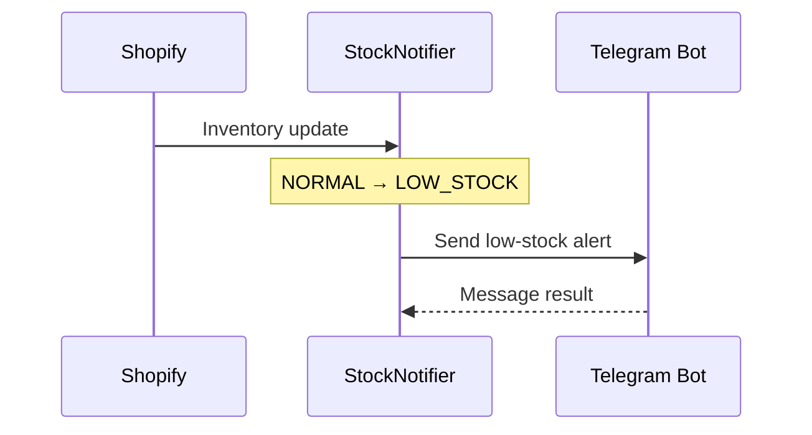

# StockNotifier — MVP Product Requirements

**Mục tiêu:** Shopify embedded app chạy local trên một Development Store. Sau M2, tự động discovery/sync tất cả active locations, theo dõi low-stock và nhận Telegram transition alerts. Không yêu cầu public release/deploy production.

Tài liệu liên quan: [Architecture](ARCHITECTURE.md) · [Database](DATABASE.md) · [Implementation Plan](IMPLEMENTATION_PLAN.md) · [Acceptance Criteria](ACCEPTANCE_CRITERIA.md).

## 1. Phạm vi MVP

| Ưu tiên | Chức năng | Kết quả tối thiểu |
| --- | --- | --- |
| P0 | Shopify auth | Cài/mở app trong Development Store, bảo vệ dữ liệu theo shop |
| P0 | Location & sync | Tự động theo dõi tất cả active locations; mỗi location có baseline/full sync riêng |
| P0 | Webhook | Nhận `inventory_levels/update`, `connect`, `disconnect`; xác thực, lọc location, dedup và đọc lại GraphQL để chống stale payload |
| P0 | Low-stock | Threshold mặc định 5, áp dụng toàn shop; quản lý chuyển trạng thái và active alert |
| P0 | Telegram | Một Bot Token trên server + một Chat ID/shop; test và gửi khi mới vào low-stock |
| P0 | Embedded UI | Dashboard inventory + Settings (location, threshold, Telegram, sync) |
| P1 | Alert history | Danh sách alert, trạng thái `ACTIVE/RESOLVED`, `PENDING/SENT/FAILED` |

M3: inventory webhooks xử lý mọi active MonitoredLocation; worker đọc lại GraphQL, xử lý lifecycle/retry/reconciliation. M4 bổ sung Dashboard, Alert history, Settings theo `stock-notifier-app/stocknotifier-dashboard-preview.html` đã duyệt và Telegram digest. Sidebar/topbar Shopify do host cung cấp; không sao chép shell giả lập.

Không làm: threshold từng variant, tự điều chỉnh stock, purchase order, supplier, AI/forecasting, dashboard analytics, email, custom RBAC, queue service/Redis, microservices, hosting production. Chỉ mở rộng WebhookEvent làm hàng đợi PostgreSQL. Dùng auth/session chính thức của Shopify.

## 2. Luồng sử dụng

1. Merchant cài app và nhập Telegram Chat ID; worker discovery tất cả active locations, không chọn location để bật/tắt monitoring.
2. Merchant gửi test message, chạy **Sync** lần đầu; app lưu snapshot inventory trong PostgreSQL.
3. Khi inventory thay đổi, Shopify gọi webhook; app cập nhật quantity, đánh giá trạng thái và ghi alert nếu mới chuyển sang low-stock.
4. Telegram nhận thông báo; merchant xem tồn kho và alert trên embedded app.
5. Merchant có thể chạy **Sync** lại để đối soát nếu webhook bị bỏ lỡ.

## 3. Business rules

- **Inventory Item** là đơn vị theo dõi, tính KPI và tạo alert theo `shop + location + inventoryItem`. Một item có thể liên kết nhiều variants; lưu danh sách metadata trong JSON, không nhân bản quantity hay alert theo variant.
- `NORMAL` nếu `availableQuantity > threshold`; `LOW_STOCK` nếu `availableQuantity <= threshold`. `OUT_OF_STOCK` (`quantity = 0`) chỉ là nhãn hiển thị, **không phải** loại alert thứ hai.
- `NORMAL → LOW_STOCK`: tạo một alert `ACTIVE`; nếu Telegram đã cấu hình, lên lịch một notification với retry hữu hạn (tối đa 3 lần thử). Không gửi hàng loạt alert cũ sau khi cấu hình Telegram.
- `LOW_STOCK → LOW_STOCK`: cập nhật quantity, không tạo/gửi alert mới.
- `LOW_STOCK → NORMAL`: resolve alert `ACTIVE` nếu có.
- `NORMAL → NORMAL`: không tạo alert.
- Sau khi restock về `NORMAL`, lần giảm tiếp theo tạo một alert mới.
- **Full Sync:** scan đủ mọi trang trước khi ghi snapshot. Chỉ sau khi scan thành công toàn bộ mới commit snapshot, đánh dấu `isCurrent = false` cho dữ liệu không còn hợp lệ, resolve active alerts tương ứng và cập nhật `lastSyncedAt`; không xóa lịch sử. Scan lỗi không ghi một phần hoặc thay đổi mốc sync thành công trước đó.
- **Baseline M2:** low-stock tạo ACTIVE alert origin BASELINE, không lên lịch gửi riêng lẻ. Lần sync đầu sau nâng cấp catch-up idempotent cho location M1: bổ sung alert low còn thiếu, giữ nguyên ACTIVE/history. Item mới hoặc trở lại current cũng nhận baseline. Các lần sync sau dùng INVENTORY_TRANSITION như webhook.
- Threshold chung toàn shop: tính lại current items tại monitored active locations; tăng làm item mới low tạo THRESHOLD_CHANGE, giảm resolve alerts không còn hợp lệ. M4 gom alerts mới của cùng operation vào một digest, không gửi từng alert, không gửi nếu không tạo alert mới.
- Sau discovery, đổi lựa chọn legacy chỉ thay preference hiển thị/compatibility, không resolve alert, vô hiệu snapshot hoặc reset baseline bất kỳ monitored location nào. Discovery đầy đủ xác minh location không còn active mới vô hiệu snapshots/resolve alerts liên quan; lỗi discovery giữ nguyên dữ liệu.
- Dashboard mặc định All locations, location selector chỉ là view filter qua URL; không đổi Settings/monitoring/baseline/alerts hoặc tự sync. KPI/table dùng snapshots current thuộc locations active, baseline hoàn tất; search/pagination phía server và scope theo shop đã xác thực. Lịch sử giữ cả inactive locations. Products đếm productGid duy nhất; items/low stock đếm snapshot item + location, không nhân theo variants.
- Digest baseline chỉ gắn alerts mới khi Bot Token và Chat ID đã có; gom theo shop/destination trong cửa sổ 30 giây, không chờ location lỗi vô hạn. Location baseline muộn hoặc item/new location mới nhận batch bổ sung. Sync lặp không tạo lại alert/batch. Migration không enroll historical PENDING; cấu hình Telegram sau không gửi ngược lịch sử.
- Digest đọc lại current eligibility trước mỗi lần gửi, bỏ alerts đã resolve/inactive; batch không còn eligible bị CANCELLED, không giả SENT/FAILED trên alert. Gửi plain text một message tối đa 4096 ký tự, chi tiết giới hạn nhưng tổng số chính xác. Chỉ sau API ok:true mới ghi SENT/notifiedAt cho batch và eligible members. Retry/lease/token bền vững trong PostgreSQL; không cam kết exactly-once khi crash sau API success.
- Không có dữ liệu tracking/quantity tại location thì không coi là quantity `0`.
- Deactivate chỉ vô hiệu snapshots/resolve alerts tại location đó, giữ history và resolution reason. Reactivate bắt đầu baseline mới; rename giữ baseline. Delete để lại tombstone, không được resurrect bởi job/scan cũ. Reconciliation phục hồi trạng thái hiện tại, không tái tạo được mọi transition trung gian khi offline.

## 4. Telegram message



Mẫu nội dung có thể copy/test:

```text
🔔 Low Stock Alert!
Inventory Item: gid://shopify/InventoryItem/123
Products / Variants: Classic T-Shirt — Black / Size M; Summer Tee — Black / M
SKU: TS-BLK-M
Location: Main Warehouse
Available Quantity: 3
Threshold: 5
Please review and restock this product.
```

Gửi thất bại **không rollback** dữ liệu tồn kho. Lưu trạng thái gửi để kiểm tra; không hứa exactly-once Telegram delivery.

Một item có nhiều variants vẫn chỉ gửi một message cho mỗi transition; tên product/variant lấy từ danh sách JSON.

## 5. Màn hình tối thiểu

- **Dashboard:** total tracked inventory items, low-stock, out-of-stock, normal, last sync; mỗi dòng là một item với danh sách Product / Variant từ JSON, SKU, Available và Status; lọc trạng thái và `isCurrent` theo quy tắc trên.
- **Settings:** chọn location, threshold nguyên không âm (default `5`), Telegram Chat ID, Send Test Notification, Sync Now.
- **Alerts (P1):** product, SKU, location, quantity lúc trigger, created/resolved time, notification status.

**Ranh giới sản phẩm:** Codex không tự bổ sung nền tảng notification, scheduler, permissions hoặc tính năng ngoài P0/P1 trên. Chi tiết kỹ thuật nằm trong [ARCHITECTURE.md](ARCHITECTURE.md); yêu cầu kiểm chứng nằm trong [ACCEPTANCE_CRITERIA.md](ACCEPTANCE_CRITERIA.md).
